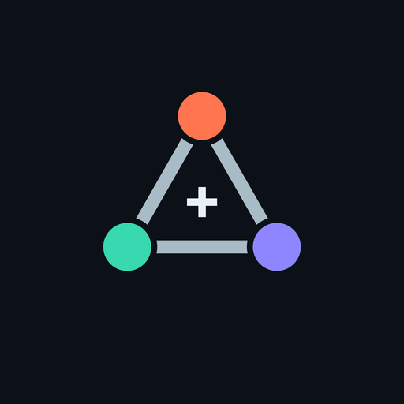
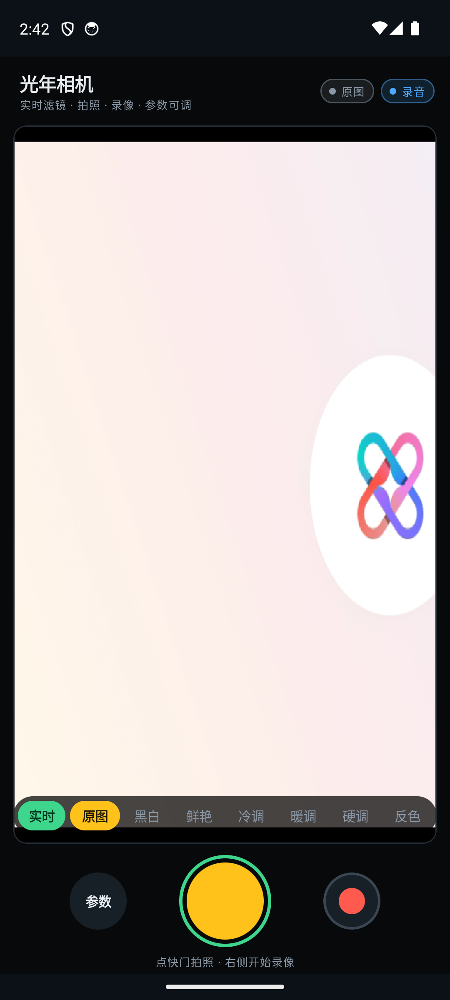
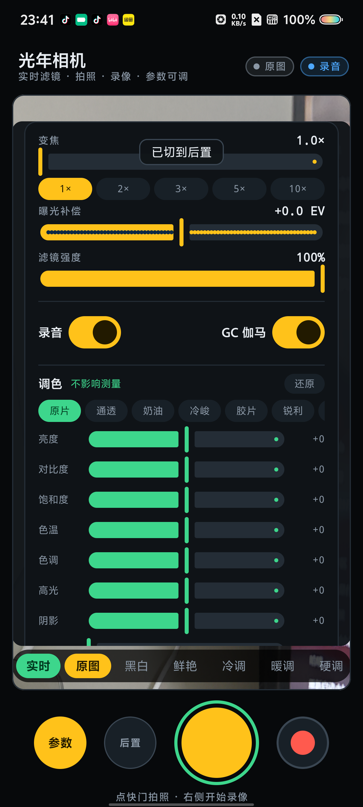
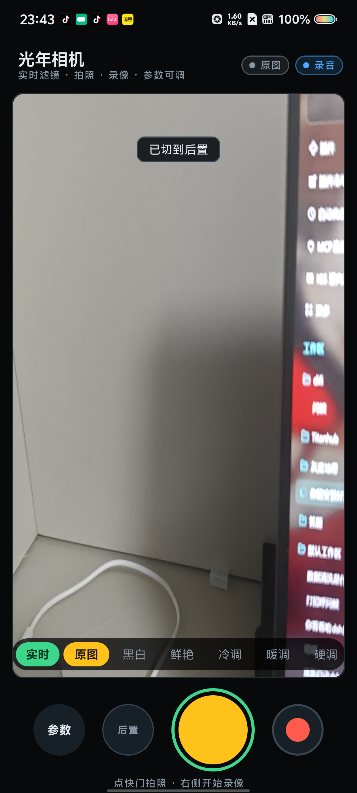
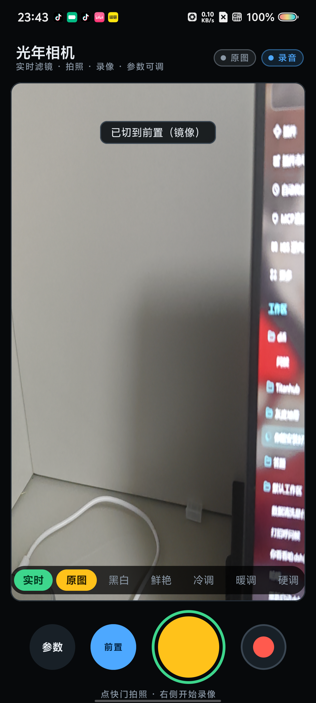
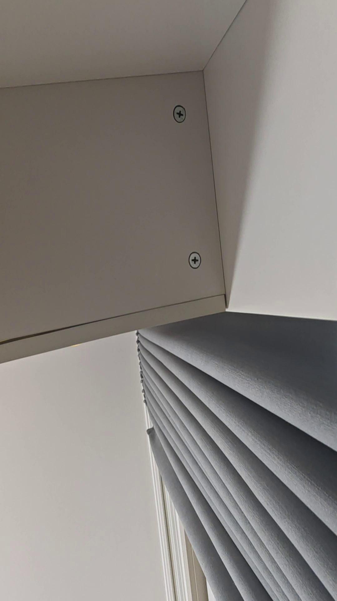
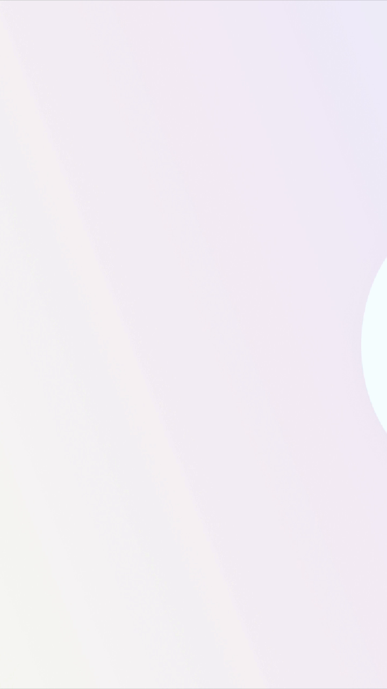

# 光年相机（Android）

一台能用的相机：**实时滤镜 · 拍照 · 录像 · 参数可调**。底层还带着测色能力（白参考 → ΔE00 判定），
但那不再是主界面 —— 现在打开就是一个相机。

- 包名：`com.spectradesk.camera`
- 目标：Android 8.0+（minSdk 26）
- 实测：Motorola XT2551-3 / Android 16、vivo V2352A / Android 16、
  Android 模拟器 API 34（x86_64，`Zhihui_API_34`）
- 大小：release 11.8 MB

```
spectradesk-android/
  app/build/outputs/apk/release/app-release.apk   ← 装机用这个
  app/build/outputs/apk/debug/app-debug.apk       ← 带日志
  branding/                                        ← 图标源文件与生成脚本
  screenshots/                                     ← 界面截图（含 lightyear-* 实机验证）
  build_apk.bat                                    ← 一键构建+安装
  run_tests.py                                     ← 跑单元测试（80 项）
```



图标语义：三个彩色采样点连成三角形，**Δ 三角形呼应 ΔE 色差**，中心准星表示精确测量。
由 `branding/generate_icons.py` 生成（8× 超采样 + 自动验证安全区），已接入 adaptive icon。

## 一、功能

| 功能 | 状态 | 说明 |
|---|---|---|
| 实时滤镜 | ✅ | 8 种观感，GPU 片元着色器，30 fps |
| 滤镜强度 | ✅ | 0–100% 连续可调，实时生效 |
| **手动调色** | ✅ | 10 项滑杆 + 7 个预设，参考剪映/醒图 |
| **前后置切换** | ✅ | 一键切换，前置自动镜像 |
| 拍照 | ✅ | 存入相册 `Pictures/LightYear` |
| 录像 | ✅ | H.264 MP4，1080×1920，存入 `Movies/LightYear` |
| 录音 | ✅ | 可开关；未授权时静默降级为无声录像 |
| 变焦 | ✅ | 滑杆 + 快捷档位（0.6/1/2/3/5/10×） |
| 曝光补偿 | ✅ | ±EV，步长按设备实测（这台是 1/10 EV） |
| 参数面板 | ✅ | 浮层 + 可滚动，不挤压取景器 |

实测截图：

| 实时滤镜 | 参数面板（全） | 调色 · 胶片预设 |
|---|---|---|
|  |  |  |

调色效果是**实时**的，且**烧进视频**：

| 调色后的取景器 | 前置（镜像） | 从录制视频抽帧 |
|---|---|---|
|  |  |  |

**滤镜确实烧进了视频**，不是只在取景器里做样子。从录好的 MP4 抽帧：

| 黑白滤镜录制的视频 | 冷调滤镜录制的视频 |
|---|---|
|  |  |

## 一·补、调色为什么单独一层

`LiveFilter` 是**预设**（选一个名字，整张画面观感就定了），`ColorGrade` 是**滑杆**
（逐项微调，作用在预设之后的成品画面上）。两者串联，顺序和剪辑软件一致。

关键决定：**预设在线性光里算，滑杆在 sRGB 域里算**。

| 层 | 域 | 为什么 |
|---|---|---|
| 预设滤镜 | 线性光 | 色彩运算的物理正确域；测色仪器必须这样 |
| 手动调色 | sRGB | 滑杆是**感知**控制，用户拿它和剪映对比，而剪映在 sRGB 域里做 |

把同一个对比度公式搬进线性光，中灰会被推坏，用户拉一下就"觉得不对"。
所以分工是：预设保色彩保真，滑杆保操作手感。

这十项是照着参考应用的实际实现挑的。用 REA 静态分析 Google Photos 的 APK，
它自带的 filterfw 图元里就有 `ColorTemperatureFilter`、`ContrastFilter`、
`VignetteFilter`、`GrainFilter`、`SharpenFilter`、`SaturateFilter` ——
和这里的色温、对比度、暗角、颗粒、锐化、饱和度一一对应。

调色**永远不进测量**：测量读的是 `ImageCapture` 的原始输出，连 GL 管线都不经过。

## 二、实时滤镜怎么做的

### 数据流

```
Camera ──► Preview use case ──► SurfaceRequest
                                     │
                          自己建 SurfaceTexture (OES)
                                     ▼
                              fragment shader
                                     │
                       ┌─────────────┴─────────────┐
                       ▼                           ▼
               取景器 SurfaceView          录像编码器 Surface
                 （自己持有）              （CameraEffect 给）
```

预览和录像走**同一套 shader**，所以录下来的就是你在取景器里看到的。

### 为什么不直接用 PreviewView

上一版用 `PreviewView` + `CameraEffect(PREVIEW|VIDEO_CAPTURE|IMAGE_CAPTURE)`，
预览上下出现黑边。排查过程值得记下来，因为每一步都排除了一个错误假设：

1. **怀疑 GL 裁剪算错** → 打印矩阵，发现 `updateTransformMatrix` 返回的已经含裁剪
   （`scaleY = -0.785`，正好是 ViewPort 比例）。GL 是对的。
2. **怀疑 ViewPort 没生效** → 三次对照（有 ViewPort / 无 ViewPort / 改 targetRotation），
   黑边位置一模一样。不是 ViewPort 的事。
3. **怀疑自己的 GL 画错** → 把清屏色改成红色、把 shader 改成纯绿输出。
   红色从没出现，绿色铺满整个取景框。**GL 覆盖范围完全正常。**
4. **真正的原因**：接入 `SurfaceProcessor` 后，CameraX 交给 PreviewView 的裁剪信息是
   竖屏 `754×1280`，而 effect 的输出缓冲是横向 `1280×960`，两者互为转置。
   PreviewView 不知道画面已经被 GL 处理过，会**再套一次**自己的
   `PreviewTransformation`，把已经画满的画面按竖屏比例又做了一次信箱（letterbox）。

这个冲突在 PreviewView 内部无解。所以取景器换成自己持有 Surface 的 `PreviewSurfaceView`，
几何 100% 由 GL 管线决定，没有第二个人再动它。

### 两个踩过的坑

| 现象 | 原因 | 修法 |
|---|---|---|
| 预览全黑 | `surfaceCreated` 早于 GL 处理器就绪，事件被丢弃 | `PreviewSurfaceView` 记住当前表面，注册回调时补发一次 |
| 画面被拉长 | `u_matrix` 含 90° 旋转，填充裁剪用错了未旋转的纵横比 | 检测四分之一转，交换宽高再算裁剪 |
| 参数面板一开就黑边 | 面板挤压取景器 → SurfaceView 缓冲区重建 → 中间露出黑底 | 参数面板改成取景器内的浮层 |

## 三、测量能力（仍在，但不再是主界面）

手机相机只有三个宽通道（大致对应红/绿/蓝），**物理上不可能测出光谱**。
三通道到光谱的映射是无穷多解的，任何"重建出来的曲线"都是先验假设的产物，不是测量。

所以测量部分只做它真能做到的事：

| 能做 | 不能做 |
|---|---|
| 测颜色（CIE Lab） | 测光谱曲线 |
| 算色差（CIEDE2000） | 识别物质成分 |
| 判定合格/超差 | 同色异谱分析 |
| 导出 CSV / HTML 报告 | 绝对精度（无出厂标定） |

**滤镜与测量的边界是硬的**：`CameraEffect` 的 targets 只含 `VIDEO_CAPTURE`，
不含 `IMAGE_CAPTURE`。测量读的是 `ImageCapture` 的原始输出，滤镜永远进不了数字。
滤镜作用于"你看到的"和"你录下的"，测量走未处理的原图。

`FiltersTest` 里有一条测试专门钉死"只有 NONE 和 GRID 是 measurement-safe"。

## 四、安装

```powershell
$adb = "$env:LOCALAPPDATA\Android\Sdk\platform-tools\adb.exe"
& $adb install -r app\build\outputs\apk\release\app-release.apk
& $adb shell am start -n com.spectradesk.camera/.MainActivity
```

或者直接把 APK 拷到手机点安装（需允许「未知来源」）。

> **release 用 debug 签名**。自己装没问题；要上应用商店必须换正式签名。

## 五、模拟器上验证

本项目在 Android 模拟器上完整验证过（`Zhihui_API_34`，Android 14 / API 34，x86_64）：

```powershell
# 启动（带摄像头映射，模拟器会把宿主摄像头当作相机）
$emu = "$env:LOCALAPPDATA\Android\Sdk\emulator\emulator.exe"
& $emu -avd Zhihui_API_34 -gpu host -camera-back webcam0 -no-snapshot-load
```

实测结论：

- GL 管线稳定 **30 fps**（`EGL_emulation: app_time_stats avg=33.3ms`）
- 预览 `1016×1724` 铺满取景器，无黑边
- 照片：`/sdcard/Pictures/LightYear/LightYear_*.jpg`
- 视频：`/sdcard/Movies/LightYear/LightYear_*.mp4`，H.264 / 1080×1920 / 30fps / AAC 立体声
- 从 MP4 抽帧确认滤镜**和调色**都已编码进视频（见上方对比图）

**模拟器的限制**：变焦不支持（`zoomRange` 返回 1.0–1.0），所以变焦滑块显示"此设备不支持变焦"。
真机上可用。

## 六、这台机器上构建的坑

**Gradle 的单元测试任务在这台机器上跑不起来**，报 `ClassNotFoundException`，
但类文件明明存在。根因是项目路径含中文（`E:\灰度地带\`）+ JVM 的
`sun.jnu.encoding = GBK`：classpath 里的中文绝对路径被错误解码。

`run_tests.py` 绕过这个问题：**cd 到 `app/build` 用相对路径**（纯 ASCII），
依赖 jar 从 Gradle 缓存按需取，AndroidX 的 AAR 现场解压出 `classes.jar`。
它跑的是同一批编译产物和同一个 JUnit，所以绿灯是可信的。当前 **80 项全过**。

其他踩过的坑：

| 现象 | 原因 | 处理 |
|---|---|---|
| `Your project path contains non-ASCII` | AGP 硬检查 | `android.overridePathCheck=true` |
| TLS handshake 中断 | 直连 Maven Central 不稳 | 换阿里云镜像 + 重试参数 |
| transforms 缓存移动失败 | Windows 文件锁 | 删 `~/.gradle/caches/8.9/transforms` |
| 启动弹「选择应用」 | 手机开了应用分身（User 900），同一包注册两次 | `pm disable-user --user 900` |
| 快门卡住不动 | 12MP JPEG 全图逐像素解码，约 1.6 秒且在主线程 | 降采样到 1200px + 移到 `Dispatchers.Default`，降到 63 ms |
| **L\* = 115** | 用三通道伪造光谱曲线算 Lab，白点归一化错误 | 改走 线性RGB→XYZ→Lab，不伪造光谱 |
| 切 GC 后读数不合理 | 旧白参考在新物理域里被复用 | 切 GC 即清标定 |
| 照片存不进相册 | 自己 insert 一行占位，CameraX 内部又 insert 一次，撞车抛异常 | 改用 `OutputStream`，只插一次 |
| `-P` 参数被吞 | PowerShell 把 `-Pandroid.overridePathCheck=true` 当成任务名 | 写进 `gradle.properties`，命令行不带 |
| `Unable to delete directory 'app\build\outputs\apk\release'` | **adb server 一直持有 `app-release.apk`** | `adb kill-server` 后再构建；或先 `push` 到 `/data/local/tmp` 再 `pm install` |
| 变焦永远 1.0× 起 | 滑杆下界写死 `1f`，且 `requireLensFacing` 会在 filter 前就收窄候选 | 下界改用 `zoomState.minZoomRatio`；朝向过滤自己写在 `addCameraFilter` 里 |
| `UnsupportedOperationException` in CameraFilter | filter 回调里读 `info.zoomState.value`，那时相机未绑定 | 改读 Camera2 静态特性 `CONTROL_ZOOM_RATIO_RANGE` |
| 曝光显示 `+1.3 EV` 实际只补了 0.7 | EV 步长写死 `/3.0`，这台设备是 1/10 | 读 `CONTROL_AE_COMPENSATION_STEP` |
| vivo 装不上（只有"取消安装"） | 超级守护管控非官方来源应用 | 手动点蓝色"授权本次安装"；授权一次后 `pm install` 就通了 |

## 七、已知边界

- **手机是色差计，不是光谱仪。** 三个宽通道决定不了光谱，App 只报颜色，
  不报光谱曲线。要光谱得上多光谱模组（桌面版支持）。
- **没有绝对精度。** 手机相机没有出厂光谱标定，读数只在同一光源、同一次白平衡下
  互相可比。跨光源比较需要重新标定。**内置的 1–3 ΔE 容差是行业常见值，不是本机的
  实测能力**——要用作质检，必须先用色卡和参考仪器做对照。
- **准星与实际采样区没有严格对齐。** Preview 和 ImageCapture 是两条独立流，
  没有共享 `ViewPort`，所以屏幕上框住的范围和照片里采样的 18% 中心区可能差一点。
  用带边界色块可以看出来。修法是 `UseCaseGroup` + `ViewPort`，还没做。
- **AE/AWB 锁是软锁。** 通过 `Camera2Interop` 设置，个别厂商 ROM 可能忽略；
  锁失败时右上角会显示「曝光未锁」，不会假装成功。
- **只有后置/前置两路**，没有 RAW、没有手电筒常亮。
- **0–1 区间（超广角）变焦拿不到 —— 这是平台限制，不是没做。** 详见下节。
- **历史只在内存**，进程被杀即丢失。
- **变焦/曝光补偿依赖设备能力**，不支持的设备上滑块会显示提示而不是假装可用。

### 为什么这台 vivo 没有 0.6× 超广角

实测 vivo V2352A / Android 16 有 **8 个 camera device**，其中一颗后置逻辑相机
`zoomRatioRange = [0.6, 10.0]`、`logicalMultiCamera.physicalIds = [3, 0]`
（超广角 + 主摄）—— 硬件上确实有超广角。

但**第三方应用只能看到 2 个**：

```
CameraManager.cameraIdList  →  ["0", "1"]
   id=0  facing=BACK   zoomRatioRange = 1.0..10.0
   id=1  facing=FRONT  zoomRatioRange = 1.0..10.0
```

`ProcessCameraProvider.getAvailableCameraInfos()` 同样只返回 2 个，
`dumpsys media.camera` 的连接记录也只有 `device 0` / `device 1`。
那颗 0.6 起的相机在 vivo 的私有 HAL 通道里，只对系统相机开放。

代码里两条路都试过了（`CameraSelector.addCameraFilter` 按 zoom 下限挑、
`CameraManager` 枚举全部 cameraId 精确匹配），结论一致：**看不到就绑不上**。
所以变焦滑杆的下界取 `zoomState.minZoomRatio` 而不是写死 1.0 ——
换一台把超广角暴露出来的机器，0.6× 会直接出现在滑杆左端，不需要改代码。

## 八、下一步

1. **准星与采样区对齐**：`UseCaseGroup` + `ViewPort` 共享视口，这是目前最明显的
   精度隐患——框住的区域和被采样的区域必须严格是同一块。
2. **3D LUT 滤镜**：现在的 8 种观感是解析式（数学公式）。真实相机 App 用
   33³ 或 17³ 的 LUT 文件（InstaShot 和 Google Photos 都是），
   `LiveFilters.sampleLut` 已经写好三线性插值，接文件即可。
3. **RAW/DNG**：走 RAW 能绕开厂商 ISP 的调色，这是唯一能接近「真实测量」的路。
4. **多点平均**：现在只取中心一块；改成 3×3 多点取中位数能进一步降噪。
5. **标定卡**：印一张已知色块卡，App 自动识别并做多点校正，能部分补偿
   手机相机非理想的光谱响应。
6. **网格线 / 画幅比例 / 定时器**：参考应用都有的取景辅助，下一步补齐。
