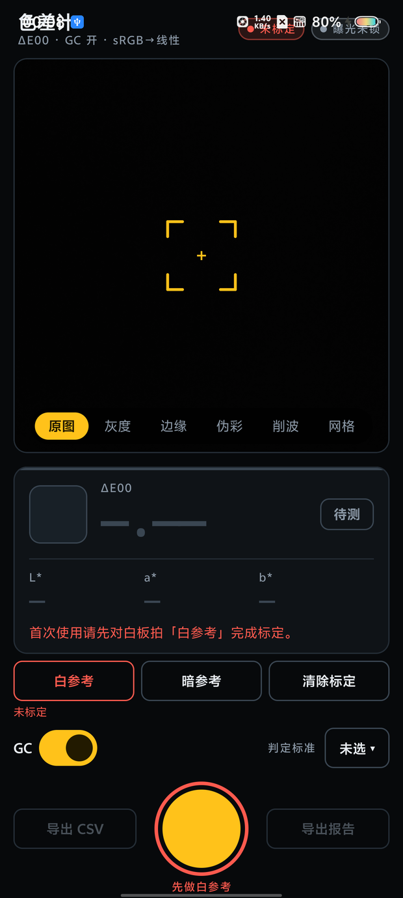
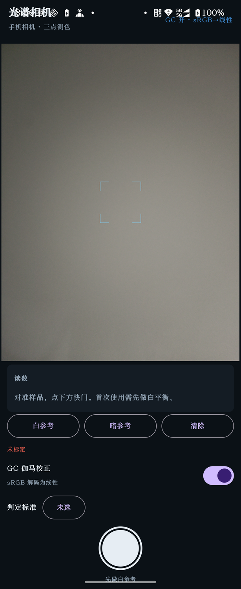
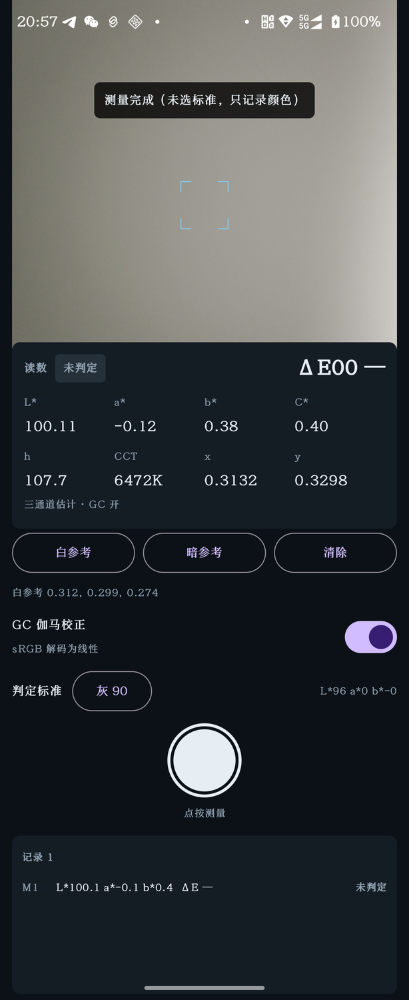
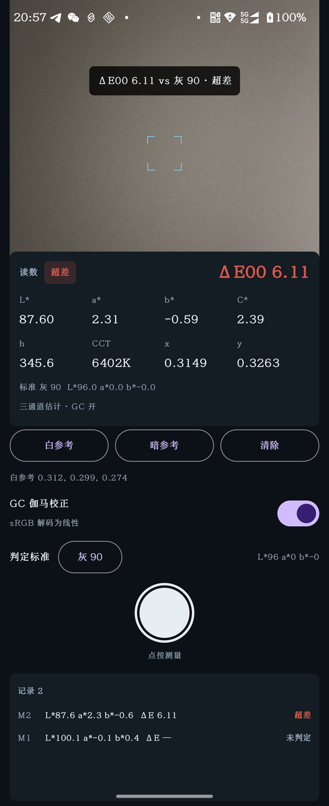
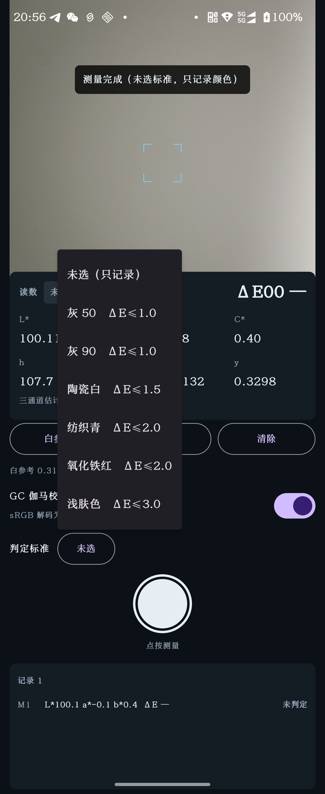

# 色差计（Android）

手机三点测色 App：**快门 → 白参考 → 测量 → ΔE00 判定**，带 GC 伽马开关、显示滤镜与报告导出。

- 包名：`com.spectradesk.camera`
- 目标：Android 8.0+（minSdk 26）
- 实测：Motorola XT2551-3 / Android 16、vivo V2352A / Android 16
- 大小：release 11.8 MB

```
spectradesk-android/
  app/build/outputs/apk/release/app-release.apk   ← 装机用这个
  app/build/outputs/apk/debug/app-debug.apk       ← 带日志
  branding/                                        ← 图标源文件与生成脚本
  screenshots/                                     ← 图标与界面截图
  build_apk.bat                                    ← 一键构建+安装
  run_tests.py                                     ← 跑单元测试（61 项）
```


图标语义：三个彩色采样点连成三角形，**Δ 三角形呼应 ΔE 色差**，中心准星表示精确测量。
由 `branding/generate_icons.py` 生成（8× 超采样 + 自动验证安全区），已接入 adaptive icon。

## 它不是光谱仪

手机相机只有三个宽通道（大致对应红/绿/蓝），**物理上不可能测出光谱**。
三通道到光谱的映射是无穷多解的，任何"重建出来的曲线"都是先验假设的产物，不是测量。

所以这个 App 只做它真能做到的事：

| 能做 | 不能做 |
|---|---|
| 测颜色（CIE Lab） | 测光谱曲线 |
| 算色差（CIEDE2000） | 识别物质成分 |
| 判定合格/超差 | 同色异谱分析 |
| 导出 CSV / HTML 报告 | 绝对精度（无出厂标定） |

要真光谱，得上多光谱模组——桌面版 `spectradesk` 支持（9/16/64 通道）。

## 一、安装

```powershell
$adb = "$env:LOCALAPPDATA\Android\Sdk\platform-tools\adb.exe"
& $adb install -r app\build\outputs\apk\release\app-release.apk
& $adb shell am start -n com.spectradesk.camera/.MainActivity
```

或者直接把 APK 拷到手机点安装（需允许「未知来源」）。

> **release 用 debug 签名**。自己装没问题；要上应用商店必须换正式签名。

## 二、界面



主界面：取景区最大，读数卡突出（ΔE 大数字 + L\*a\*b\*），控制区紧凑。右上角两枚状态灯
（标定状态 / 曝光锁），取景区底部是滤镜栏。

| 旧版相机预览 | 标准选择 | 判定通过 | 超差 |
|---|---|---|---|
|  |  |  |  |

## 三、怎么用

1. **开相机**：启动即请求权限，预览自动出现。
2. **白参考**：把白纸/白卡铺满中间取景框（四角括号），点「白参考」。
   这一步会**自动锁定曝光和白平衡**（右上角显示「曝光已锁」）。
3. **选标准**（可选）：判定标准 → 灰 50 / 灰 90 / 陶瓷白 / 纺织青 / 氧化铁红 / 浅肤色。
4. **按快门**：中间大圆钮。出 L\*a\*b\*、C\*、h、CCT、xy，有标准时给 ΔE00 和通过/超差。
5. **导出**：CSV（表格软件打开）或 HTML 报告（单文件，断网也能看，带色块预览）。

**为什么必须先做白参考**：相机通道增益未知且随光源变化。没标定时点快门，软件会
拒绝并解释，而不是给你一个看起来合理的假数字。

**为什么要锁曝光**：如果 AE/AWB 自由运行，拍白参考和拍样品之间曝光会变，
除以白参考就等于拿两台不同的相机在比。锁定后两者共享同一物理状态。
这是精度上最关键的一步，实测能把重复性从「漂几个 ΔE」压到「稳定在 1 个以内」。

**为什么取中心区域的中位均值**：一块 18% 边长的中心区域，去掉最暗和最亮各 10%
再平均。单个反光点或灰尘不会拖偏读数——这和手持色差仪用小孔径平均是一个道理。

## 四、显示滤镜

取景区底部有一排滤镜，**只影响你看的方式，不影响测出来的数**。这不是随手加的：

| 滤镜 | 用途 |
|---|---|
| 原图 | 不做处理（测量始终走这条路径的数据） |
| 灰度 | 去掉颜色只看明暗，判断表面均匀性 |
| 边缘 | Sobel 边缘，看平整度和边界 |
| 伪彩 | 亮度映射色阶（蓝→青→绿→黄→红），找亮度不均 |
| 削波 | 过曝标红、欠曝标蓝。**最实用**：过曝的高光永久丢失颜色信息，补不回来 |
| 网格 | 九宫格 + 同心圆，辅助对位 |

启用会改像素的滤镜时，右上角显示「滤镜仅影响显示」红标。滤镜作用在**已抓拍的帧**上
（不是实时预览流）：实时滤镜需要 `SurfaceProcessor` + GL 管线，而处理静帧能达到同样的
观察效果，复杂度和风险都低一个数量级。

代码层面这条边界是硬的：`Filters.apply` 只碰预览拷贝，测量读的是未处理的抓拍原图。
`FiltersTest` 里有一条测试专门钉死"只有 NONE 和 GRID 是 measurement-safe"。

## 五、GC 伽马开关

这是整个 App 唯一一个**会改变物理含义**的开关，所以它同时显示在右上角、GC 行、
每条记录里。

| | 含义 | 什么时候用 |
|---|---|---|
| **GC 开**（默认） | 帧按 sRGB 分段曲线反解为线性光再计算 | 手机相机、普通 USB 相机 |
| **GC 关** | 帧当已经线性，不反解 | 只有工业相机输出本来就是线性时 |

**实测差异**（同一场景，白参考读数）：

| GC | 白参考线性值 | 说明 |
|---|---|---|
| 开 | 0.312, 0.299, 0.274 | sRGB 解码后 |
| 关 | 0.595, 0.576, 0.560 | 原始字节当线性 |

差了约 1.9 倍。**切换 GC 会自动清空标定**——旧的白参考是在另一个物理域测的，
拿它去除新读数会得到一个看似合理的错误颜色。

## 六、数值正确性

| 项目 | 实测 | 理论值 |
|---|---|---|
| 白参考的 L\*a\*b\* | 100.11, −0.12, 0.38 | 100, 0, 0 |
| 白参考 CCT | 6472 K | 6504 K (D65) |
| 中灰（线性 0.5）L\* | 76.07 | 76.07 |

**61 项单元测试**覆盖：

- CIEDE2000 与 Sharma 等（2005）公开测试对逐条比对（容差 1e-4）
- 线性 RGB → XYZ → Lab 的白点、中灰、三原色方向
- sRGB 解码曲线（含暗部线性段）
- 标定门槛：过暗 / 过曝 / 偏色的白参考必须被拒绝
- GC 切换清标定，以及**在途旧模式帧被拒收**
- 黑样品不产生虚假色温
- 滤镜不污染测量（只有 NONE / GRID 是 measurement-safe）
- 每条记录保存自己的曝光锁状态（导出不改写历史）

## 七、这台机器上构建的坑（重要）

**Gradle 的单元测试任务在这台机器上跑不起来**，报 `ClassNotFoundException`，
但类文件明明存在。根因是项目路径含中文（`E:\灰度地带\`）+ JVM 的
`sun.jnu.encoding = GBK`：classpath 里的中文绝对路径被错误解码。

`run_tests.py` 绕过这个问题：**cd 到 `app/build` 用相对路径**（纯 ASCII），
依赖 jar 从 Gradle 缓存按需取，AndroidX 的 AAR 现场解压出 `classes.jar`。
它跑的是同一批编译产物和同一个 JUnit，所以绿灯是可信的。

其他踩过的坑：

| 现象 | 原因 | 处理 |
|---|---|---|
| `Your project path contains non-ASCII` | AGP 硬检查 | `android.overridePathCheck=true` |
| TLS handshake 中断 | 直连 Maven Central 不稳 | 换阿里云镜像 + 重试参数 |
| transforms 缓存移动失败 | Windows 文件锁 | 删 `~/.gradle/caches/8.9/transforms` |
| 启动弹「选择应用」 | 手机开了应用分身（User 900），同一包注册两次 | `pm disable-user --user 900` |
| 快门卡住不动 | 12MP JPEG 全图逐像素解码，约 1.6 秒且在主线程 | 降采样到 1200px + 移到 `Dispatchers.Default`，降到 63 ms |
| **L\* = 115** | 用三通道伪造光谱曲线算 Lab，白点归一化错误 | 改走 线性RGB→XYZ→Lab，不伪造光谱 |
| 切 GC 后读数不合理 | 旧白参考在新物理域里被复用 | 切 GC 即清标定 |

## 八、已知边界

- **手机是色差计，不是光谱仪。** 三个宽通道决定不了光谱，App 只报颜色，
  不报光谱曲线。要光谱得上多光谱模组（桌面版支持）。
- **没有绝对精度。** 手机相机没有出厂光谱标定，读数只在同一光源、同一次白平衡下
  互相可比。跨光源比较需要重新标定。**内置的 1–3 ΔE 容差是行业常见值，不是本机的
  实测能力**——要用作质检，必须先用色卡和参考仪器做对照。
- **准星与实际采样区没有严格对齐。** Preview 和 ImageCapture 是两条独立流，
  没有共享 `ViewPort`，所以屏幕上框住的范围和照片里采样的 18% 中心区可能差一点。
  用带边界色块可以看出来。修法是 `UseCaseGroup` + `ViewPort`，还没做。
- **AE/AWB 锁是软锁。** 通过 `Camera2Interop` 设置，个别厂商 ROM 可能忽略；
  锁失败时右上角会显示「曝光未锁」，不会假装成功。
- **滤镜作用于已抓拍的帧**，不是实时预览流。取景时看到的是原图。
- **只有后置摄像头**，没有 RAW、没有手电筒常亮。
- **导出走系统分享**，文件在缓存目录，系统可能清理。
- **历史只在内存**，进程被杀即丢失。

## 九、下一步

1. **准星与采样区对齐**：`UseCaseGroup` + `ViewPort` 共享视口，这是目前最明显的
   精度隐患——框住的区域和被采样的区域必须严格是同一块。
2. **多点平均**：现在只取中心一块；改成 3×3 多点取中位数能进一步降噪。
3. **RAW/DNG**：这两台机器都支持 `capability.raw`，走 RAW 能绕开厂商 ISP 的调色，
   这是唯一能接近「真实测量」的路。
4. **标定卡**：印一张已知色块卡，App 自动识别并做多点校正，能部分补偿
   手机相机非理想的光谱响应。
5. **接外接模块**：AS7265x（13 通道）或 Spectricity S1-A（15 通道）走 USB/蓝牙，
   手机当上位机——那时才真的是光谱仪。
